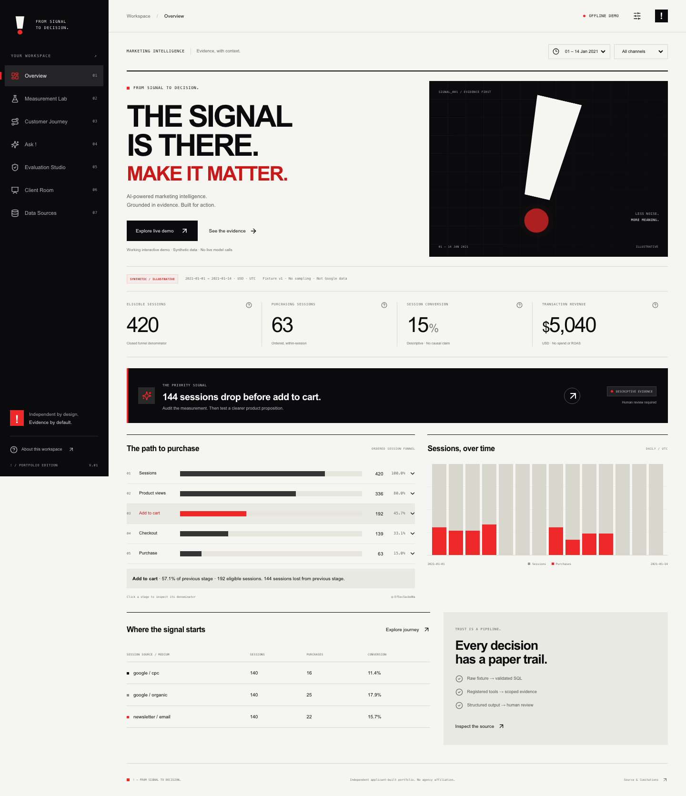
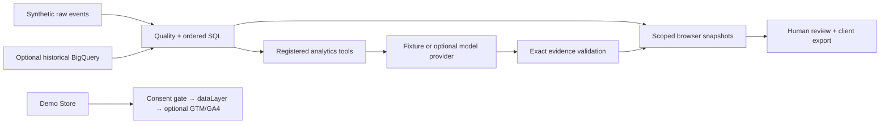

# !

### FROM SIGNAL TO DECISION.

**AI-powered marketing intelligence. Grounded in evidence. Built for action.**

A working, AI-assisted portfolio built around one question: **what decision does this evidence actually support?** Instrument a demo purchase, inspect an ordered funnel, question a bounded analyst, investigate evaluation failures and export a reviewed client recommendation.



**No credentials needed for the complete offline experience.** The public demo uses **SYNTHETIC / ILLUSTRATIVE** events and a **deterministic fixture analyst**. It makes no live model calls. Public Google historical data, owner GA4/GTM and actual model results are separate, explicitly unverified integrations.

**[Open the working GitHub Pages demo](https://yashayyy27.github.io/exclamation-ai/)** · **[Source code](https://github.com/yashayyy27/exclamation-ai)** · [Hosted CI](https://github.com/yashayyy27/exclamation-ai/actions/workflows/ci.yml) · [Release evidence](docs/release.md)

Published to the authenticated owner’s public repository and GitHub Pages. The deployed Overview and Evaluation Studio were checked in a browser; the recorded fixture run loads correctly under the project URL. Hosted CI has passed, including desktop/mobile browser tests. Further pushes rerun verification automatically.

## Recruitment audit: evidence you can inspect

The [prioritised independent audit](docs/audit/2026-10-22-gap-report.md) found a real validation defect: two near-equal copies of one metric could replace another. The [recorded replay](docs/evidence/validator-replay.json) shows baseline **ACCEPTED** and upgraded **REJECTED**. This is a synthetic adversarial provider test, not an invented model failure. The public deterministic ROAS failure remains inspectable in Evaluation Studio.

The upgrade adds genuine model tool choice, a separate bounded release-evaluation harness with independent numeric oracles, content/SQL lineage hashes, GoogleSQL reconciliation, explicit paid-call opt-in, campaign uncertainty, absolute/proportional funnel priorities and a separate attribution sensitivity example. The [readiness matrix](docs/rga-role-evidence-matrix.md) links code, tests and demo evidence. The [verification report](docs/verification.md) records observed results and remaining owner gates. **Live OpenAI quality, BigQuery results and GTM/GA4 receipt remain unverified.**

Start with the [three-minute walkthrough](docs/demo-script.md), [six-slide client PDF](docs/deliverables/client-review.pdf) and [marketing decision framework](docs/marketing-framework.md). Everything is advisory; no client use, uplift or applicant-only authorship is claimed.

## Run it in one minute

Requirements: Node 24 LTS and npm. Python is optional for browsing; use Python 3.12+ to reproduce the analytics pipeline, tests and API.

```sh
git clone https://github.com/yashayyy27/exclamation-ai.git
cd exclamation-ai
npm ci
npm run dev
```

Open `http://127.0.0.1:5173`. No cloud account, API key, database or payment setup is required. Hash-based navigation works on static hosts.

For the full engineering workflow:

```sh
python3.12 -m venv .venv
.venv/bin/python -m pip install -r requirements.lock
make check            # Python lint/types/tests + browser unit tests + TS/build
make eval             # deterministic development cases, not a model score
make eval-heldout     # separate release cases + independent numeric oracle
npx playwright install chromium
npm run test:e2e      # desktop/mobile flows and axe scans
make dev              # web :5173 + API :8000; Ctrl-C stops both
```

`make api` starts only the backend. `GET /health`, `GET /analytics` and `POST /ask` work locally. Optional external providers require server-side credentials and API access token; see [owner setup](docs/MANUAL_SETUP_ACTIONS.md). Python does not automatically load `.env`. Vite loads its public configuration from `apps/web/.env.local`.

## A 90-second tour

| Time | Try this | What it proves |
|---|---|---|
| 0–20s | Overview → change date/channel → inspect a funnel stage | Real scoped counts with a defined denominator and query ID |
| 20–40s | Measurement Lab → product → cart → demo checkout | Eight valid events, consent-gated delivery, unique synthetic transaction, no PII/payment |
| 40–60s | Ask ! → funnel question → ROAS question | Approved tool/evidence path and an honest abstention |
| 60–75s | Evaluation Studio → baseline → failures → ROAS | A real failure, separate grades and a traceable policy repair |
| 75–90s | Client Room → edit → review → PDF | One recommendation, source limitations and a test plan that travel together |

The [three-minute technical script](docs/demo-script.md) adds architecture and experiment design. The [role evidence matrix](docs/rga-role-evidence-matrix.md) maps each competency to code, tests and demo moments.

## Engineering evidence

- **Raw events → genuine SQL.** 1,153 invented records; two duplicates and one invalid record. Three read-only SQL transformations establish event, session and transaction grains. Ground truth: 420 sessions → 336 product views → 192 cart sessions → 139 checkouts → 63 purchases. Ordered conversion: 15%. Deduplicated illustrative revenue: USD 5,040. None is an observed client result.
- **Evidence travels with a claim.** Metrics carry unit, date window, source ID and query ID. The validator rejects changed values, units, dates, sources and citations. Empty evidence abstains. Two failed validation attempts return REVIEW_REQUIRED.
- **Bounded model integration.** An optional real OpenAI Responses provider uses strict function calling and structured output. The server scopes the intent and filters, offers six tools plus abstention for genuine model selection, calculates registered aggregates and verifies the result. The model selects constrained finding/action types; it cannot write arbitrary SQL or unsupported numeric prose. Actual API behavior is NOT YET VERIFIED. Unknown token usage is null; validation retries accumulate known usage rather than overwriting it.
- **Real measurement code.** Product/list/cart/checkout actions produce schema-validated dataLayer contracts. Google tags load only after analytics consent, with advertising consent denied. GTM is the single delivery path. Local event QA does not pretend to be live GA4 collection.
- **Source-aware BigQuery adapter.** One fixed public table, parameterized dates, dry runs, a hard maximum of 1 GB billed, timeouts and refusal of incomplete extracts above 200,000 rows. SDK protocol/cost guards are mocked tests; real Google execution remains unverified.
- **Decision before decoration.** A priority transition, descriptive source comparison, honest attribution insufficiency, sample-size assumptions and editable client output make the next action reviewable.



React/TypeScript/Vite makes the demo portable. FastAPI/Pydantic keeps typed analytics and optional credentials server-side. SQLite makes real SQL reproducible without a native data engine or cloud account. Static deployment exposes no paid API endpoint. [Architecture and trade-offs](docs/architecture.md).

## Evaluation, with the right claims

The [36 committed cases](evals/cases/golden.json) cover KPI ground truth, funnels/channels, definitions, ambiguity, missing evidence, unsupported claims, privacy, injection and a deliberate mocked API failure. Seventeen cases expect abstention; the API-failure case expects REVIEW_REQUIRED.

| Recorded fixture policy | Passed | Interpretation |
|---|---:|---|
| Baseline v1 | 21/36 | Missing explicit unsupported-claim guards |
| Revised v2 | 36/36 | Deterministic routing + evidence/safety policy on development fixtures |
| Live model | NOT YET VERIFIED | No key configured, no actual model call or model-quality score |

**These scores do not demonstrate an LLM improvement.** The v1/v2 fixture comparison changes routing/guard behavior. Both prompt files exist, but their live semantic effect is unmeasured. Numerical, lineage, abstention, tool and schema grades are separate. Tokens and cost are null, not invented zeros. Timing is actual local harness elapsed time. The deliberate failure case is clearly labelled as simulated.

Read the [generated evaluation report](docs/evaluation-report.md), inspect [per-case JSON](evals/runs/fixture-latest.json), or reproduce with `make eval`. The separate [24-case release harness](evals/heldout.py) records immutable hashed runs and actual model choices, abstention, numerical accuracy, grounding, injection probes and a bounded action rubric. Its deterministic first run was 23/24; an ambiguous denominator question required an oracle correction, retained in the [failure analysis](docs/failure-analysis.md). The corrected run is 24/24. This set has now been inspected; it is not untouched generalization evidence. Real model results and independent human recommendation ratings remain absent. Paid commands require approval and an explicit request ceiling; see [integration verification](docs/integration-verification.md).

## Client deliverables

The app exports an editable executive Markdown note and a six-slide PDF after a review checkpoint. Editing or changing analytics scope resets review. Committed [executive note](docs/deliverables/executive-note.md) and [six-slide PDF](docs/deliverables/client-review.pdf) remain **DRAFT / NOT REVIEWED**: automated test clicks do not constitute human approval. Regenerate with Node 24: `node scripts/export_client.ts`.

The narrative covers the business question, source boundaries, defined performance, journey finding, one recommendation and experiment ownership/success criteria. See [client story and skeptical-client Q&A](docs/client-story.md), [interview talking points](docs/interview-story.md) and the [next-iteration PRD](docs/next-iteration-prd.md).

## What is verified, and what is not

See [IMPLEMENTATION_STATUS](IMPLEMENTATION_STATUS.md) and [actual command logs](docs/evidence/checks.txt). Local automated checks cover Python SQL/agent/API safety, browser policy parity/event contracts, TypeScript/build, desktop/mobile purchase and export journeys and axe scans on seven pages. [QA instructions and limits](docs/qa-guide.md).

| Integration | Release state |
|---|---|
| Synthetic fixture / deterministic analyst | Implemented and tested end to end |
| FIRST-PARTY DEMO EVENTS | Working local QA and consent-gated dataLayer; no dashboard mixing |
| GOOGLE PUBLIC / HISTORICAL | Real adapter implemented; live connection NOT YET VERIFIED |
| Owner GA4/GTM | Collection code and setup guide; external Tag Assistant/DebugView NOT YET VERIFIED |
| OpenAI | Real SDK provider + mocked protocol tests; actual model calls NOT YET VERIFIED |
| Multi-touch attribution / causal impact / ROAS | Insufficient evidence; not fabricated |
| Durable multi-user approval / production tenancy | Planned; local review flag only |

Known limitations: rule-based intent coverage can over-refuse; weekly subwindows are too short for the adjacent equal-period comparison; public data is obfuscated; boundary sessions can be truncated; public traffic_source is acquisition metadata; no actual spend, uplift, clients or usage. Automated accessibility checks are not a screen-reader certification. The current SDK emits a TestClient deprecation warning; tests still pass. [Source provenance](docs/data-provenance.md) and [metric dictionary](docs/metric-dictionary.md).

## Handover

- [Measurement framework](docs/measurement-plan.md), [GTM setup](docs/gtm-setup.md), [QA guide](docs/qa-guide.md)
- [Owner credential/deployment actions](docs/MANUAL_SETUP_ACTIONS.md), [design system](docs/design-system.md)
- [Build phases and verification history](docs/phases.md), [role evidence matrix](docs/rga-role-evidence-matrix.md)
- `apps/web/src/pages/`: seven functional workspace pages; `components/`: shared charts and evidence UI
- `services/api/`: analytics, bounded agent, typed schemas, API and BigQuery adapter
- `data/sql/`, `data/fixtures/`, `evals/`, `tests/`, `.github/workflows/`: reproducible engineering evidence

CI checks lint, types, tests, build, dependency audit, secret patterns and browser flows. A weekly fixture evaluation workflow is included; hosted run status is only claimed once observed. `scripts/scan_secrets.py` checks tracked paths and common credential patterns without printing values; it is not a complete security audit.

Independent applicant-built portfolio, tailored to analytics and evaluation competencies in the R/GA Data Analyst brief. **Not affiliated with or endorsed by R/GA.** Original code: MIT. Dependencies retain their own licenses. Product name: **!**. `exclamation-ai` is the repository/package slug only.
