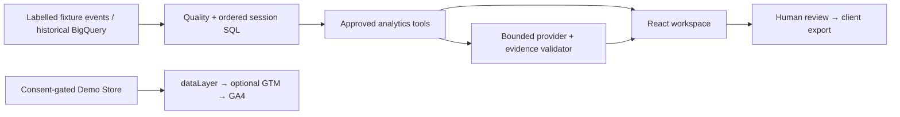

# ! — architecture and build order

1. React/TypeScript/Vite workspace + Python FastAPI; credential-free fixture experience first.
2. Deterministic raw synthetic ecommerce events → SQLite read-only transformations → audited metrics. BigQuery adapter uses fixed templates, date parameters, dry runs and a hard byte cap.
3. Approved analytics tools → deterministic demo provider OR optional OpenAI Responses provider → Pydantic evidence validation → human-reviewed client output. Fixture evaluation is never described as model evaluation.
4. Responsive editorial UI, actual browser QA, downloadable reviewed report and six-slide client PDF, CI, publication if authenticated.

The browser offline adapter reads a generated, checked-in analytics snapshot produced by Python from raw events. It is a working deterministic demo, not a model simulation advertised as AI. FastAPI supplies the same tools and optional model/BigQuery adapters locally. Static hosting can run the whole fixture experience without exposing paid endpoints. No multi-tenant or arbitrary SQL API. The model name and all credentials are server configuration. Source modes stay separate.

Trade-offs: Vite over Next.js keeps a portable static public demo and a small Python analytics backend. SQLite over DuckDB needs no extra native runtime and exercises genuine SQL. Public fixture endpoints hold no secrets. Live API operation is opt-in and requires server-side credentials and an access token. No real spend, causal claims or cross-device attribution.

Upgrade: OpenAI receives a user question that passes the limited server policy, then chooses among six registered tools plus abstention. The server checks its choice against approved intent; mismatch fails closed. Strict structured authoring must carry each evidence identity exactly once. Aggregate dimension labels remain untrusted. No guarantee is made that the lexical privacy guard detects all personal information; do not enter personal data. API external calls require access token plus OWNER_ALLOW_PAID_CALLS=1. The owner evaluation command also requires explicit approval and a finite request ceiling. See [integration verification](integration-verification.md).

Snapshot query IDs include raw-content and transformation hashes. Google dataset availability and actual extraction bounds are separate. Diagnostic priorities and a separate synthetic attribution example never assert causal effects.
