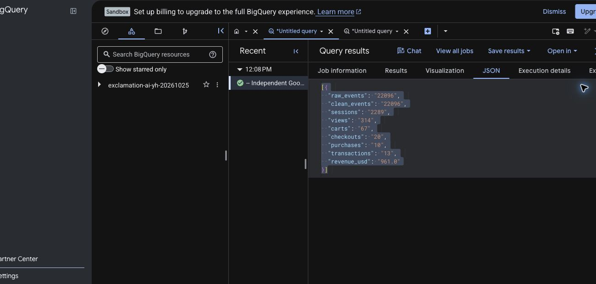

# One genuine BigQuery analysis

**Verified on 25 October 2026.** Three read-only jobs ran in the owner's authenticated Google Cloud Console, in a newly created **unbilled BigQuery sandbox**. No billing account or trial was activated. This is genuine Google execution followed by a complete local export reconciliation. **The Python SDK authentication/transport path remains unverified.**

Business question: **where should an analyst investigate lost progression before recommending a conversion experiment or channel budget change?** This is a historical public-data exercise, not a client engagement or current commercial result.

## Actual results and reconciliation

Source: `bigquery-public-data.ga4_obfuscated_sample_ecommerce.events_*`, **1 January 2021, UTC**, USD `purchase_revenue_in_usd`. The existing registered extraction and independent aggregate queries were run with both date parameters replaced by the literal `'20210101'`. The entire **22,096-row** result was downloaded locally, below the 200,000-row completeness limit. All **nine** local SQLite results matched the separately executed GoogleSQL aggregate.

| Measure | GoogleSQL | Local pipeline | Definition |
|---|---:|---:|---|
| Raw events | 22,096 | 22,096 | All events in the bounded extract |
| Clean events | 22,096 | 22,096 | Fingerprint deduplication, valid IDs/time, nonnegative USD revenue |
| Sessions | 2,289 | 2,289 | Distinct user/session keys with `session_start` in scope |
| Product-view sessions | 314 | 314 | `view_item` at/after session start |
| Cart sessions | 67 | 67 | `add_to_cart` at/after product view |
| Checkout sessions | 20 | 20 | `begin_checkout` at/after cart |
| Completed-funnel sessions | 10 | 10 | Valid-ID purchase at/after all preceding stages |
| Distinct transactions | 13 | 13 | Deduplicated transaction ID, joined to an in-scope started session |
| Revenue (USD) | 961.00 | 961.00 | Maximum recorded USD value per transaction ID, then sum |

The completed-funnel session rate is **10 / 2,289 = 0.4369%**. Thirteen transactions and ten ordered purchasers are different measures: transaction counting does not require the complete preceding event sequence, and a session can contain multiple transactions. The difference alone does not establish missing instrumentation or a site defect. No GA4 UI conversion-rate parity is claimed.



## Date and cost checks

A third query inspected 31 December, 1 January and 2 January partitions. They contained 24,537, 22,096 and 23,599 events respectively; **zero** events in either adjacent partition fell within the requested UTC day. All 22,096 events in the middle partition did. Its timestamps span `2021-01-01 00:00:08.136569 UTC` to `2021-01-01 23:59:55.455070 UTC`. This verifies this day's partition/UTC coverage, not every date or property timezone. Sessions crossing midnight can still be incomplete.

| Actual job | Estimated / processed scan, Console display | Billed-byte display | Duration |
|---|---|---|---|
| Aggregate `job_S0wvGXqaYjJKFUGt5NRvECL51WCZ` | 7.66 MB / 7.66 MB | 10 MB | 2,441 ms |
| Extract `job_npAREqOfGZQFYO-y5h1F_FBfmvnL` | 8.3 MB / 8.3 MB | 10 MB | 1,281 ms |
| Boundary audit `job_C6HzR2WAklEJ3ejXa6P3Ig1pMAF_` | 548.69 KB / 548.69 KB | 10 MB | 383 ms |

Location: **US**. Estimates were inspected before each execution. The Console displays **Sandbox**, with billing setup required to upgrade. These runs incurred **no paid query charges** under that unbilled mode; the billed-byte displays are usage accounting, not dollar invoices. Exact API byte counters, cache status and a per-query maximum-bytes setting were not retrieved/configured in the Console. Those values remain null in the receipt. This does not verify the SDK's mocked cost guards. Google's [sandbox documentation](https://docs.cloud.google.com/bigquery/docs/sandbox) explains the no-charge mode and quotas.

## Decision supported by the evidence

The largest loss is session → product view: **1,975 / 2,289 = 86.28%**. Product view → cart loses **247 / 314 = 78.66%**; checkout → purchase loses **10 / 20 = 50%**. The existing loss-volume × loss-fraction heuristic ranks session → product first. It is a diagnosis priority, not recoverable demand or an uplift forecast.

**Prioritised recommendation: validate product-reach measurement and landing intent before changing checkout or reallocating media.** Competing explanations include non-shopping session intent, obfuscation, incomplete boundary sessions, incomplete event sequences and genuine product-discovery friction. This extract cannot distinguish them. In an owner property, inspect landing-page cohorts, consent coverage and event delivery first. Only after measurement QA, preregister a product-discovery experiment with an eligible-session denominator, a minimum meaningful effect, purchase/revenue guardrails and enough independent units; do not infer an experiment sample size from ten observed funnel completions.

The acquisition-group comparison is descriptive. For example, `google / cpc` has **1 / 103** ordered purchasers (0.9709%, Wilson 95% interval 0.17–5.30%); `google / organic` has **2 / 746** (0.2681%, interval 0.07–0.97%). These small, overlapping intervals and first-user acquisition fields do not justify a budget recommendation. Repeat sessions also weaken the independent-session interval assumption. Spend and matched touchpoints are unavailable, so ROAS and causal attribution remain unavailable.

Quality counters report no duplicates, invalid identifiers or missing purchase revenue under this extract's rules. That is not a clean bill of health: `<Other>` and `(data deleted)` acquisition groups are present. Google documents obfuscation and limited internal consistency, and explicitly says this dataset differs from its Analytics demo account. See [Google's source documentation](https://developers.google.com/analytics/bigquery/web-ecommerce-demo-dataset).

## Inspect and reproduce

- [Actual downloaded aggregate](evidence/bigquery-console-20261025-oracle.json) and [adjacent-partition output](evidence/bigquery-console-20261025-scope.json).
- [Sanitised job receipt](evidence/bigquery-console-20261025-jobs.json): job IDs, observed timings/scan displays, query hashes, source/code identity and verification boundaries. Google Console job links require owner access; they do not grant repository readers access.
- [Actual local reconciliation](evidence/bigquery-console-20261025-reconciliation.json): nine comparisons, hashes, quality checks, funnel priorities and acquisition intervals. No raw user/session identifiers are published.
- [Extraction SQL](../data/sql/bigquery_events.sql), [independent aggregate SQL](../data/sql/bigquery_reconcile.sql), [date audit SQL](../data/sql/bigquery_scope_audit.sql), [offline export command](../scripts/reconcile_bigquery_export.py), [regressions](../tests/test_console_export.py).

In your own unbilled sandbox, inspect each estimate and execute these fixed read-only templates for the same date. Save the **entire** extraction and aggregate with **Save results → Local download → JSON**. Then run:

```sh
.venv/bin/python scripts/reconcile_bigquery_export.py \
  --extract /absolute/path/to/event-export.json \
  --oracle /absolute/path/to/aggregate-export.json \
  --start 2021-01-01 --end 2021-01-01 \
  --output /absolute/path/to/new-reconciliation.json
```

The command refuses partial exports, out-of-window events and fractional INT64 fields; a numeric mismatch or unavailable monetary check cannot pass. It preserves earlier output files. **It verifies supplied files' arithmetic, not Google authentication or their origin.** The separate job exports and authentic screenshot establish the observed Console run. The raw local export's SHA-256 is `a20aaabd192d50b5ce33e74d162b60f819e0f2d06a10c5797ed29eaf7931f4bd` (8,170,612 bytes). Raw obfuscated identities stay outside Git.

The GitHub Pages dashboard and client presentation still use their explicitly synthetic fixture. This one-day historical analysis is a separate source. The later [owner GA4/GTM Preview receipt](google-tracking-2026-10-26.md) verifies separate local test-event delivery. An authenticated OpenAI evaluation was not run; no paid verification is currently authorized. This historical analysis verifies neither model quality nor first-party export delivery.
